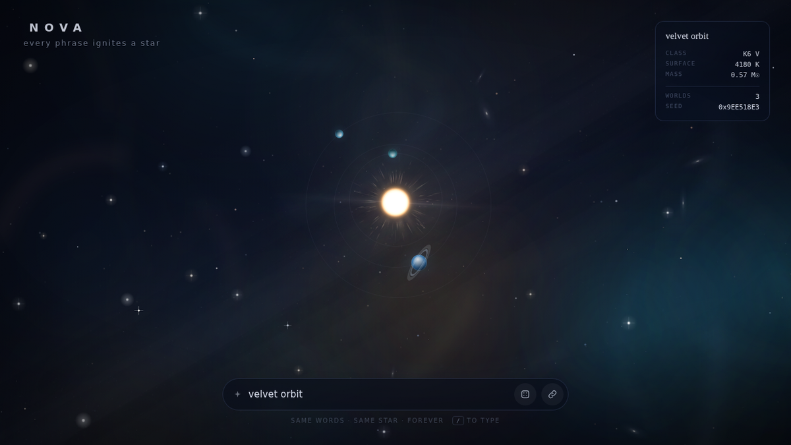

# NOVA

> **Every phrase ignites a star.**

Type any phrase and Nova ignites a star system from it — a specific star, at a specific temperature, with its own worlds, dust and light. The same words always produce the same star, on any device, forever.

Deterministic generative astronomy in **one self-contained HTML file**. No build step, no dependencies, no network calls.

<!-- Replace this line with a GIF once you record one -->


---

## How it works

A phrase is not "random" — it is *seeded*.

```
"the last good summer"
        │
        ▼  FNV-1a  (32-bit hash)
   0x4E8C836A
        │
        ▼  mulberry32 PRNG
   mass · temperature · spectral class · worlds · dust · nebula · spin
```

1. **Hash** — the phrase is normalised (trimmed, lowercased) and run through FNV-1a to get a 32-bit seed.
2. **Seed** — that seed drives a `mulberry32` PRNG. Every visual property is drawn from it in a fixed order.
3. **Classify** — a spectral class is sampled first (`M → K → G → F → A → B`), then a temperature is drawn log-uniformly inside that class's band, so you get genuine variety instead of a hundred lukewarm dots.
4. **Render** — temperature and mass set the star's colour, size and luminosity. Limb darkening, corona rays, diffraction spikes and an anamorphic streak are pre-baked into an offscreen sprite once, then composited each frame.

Because nothing depends on `Math.random()` or the clock, the seed shown in the readout *is* the star. Share the URL, share the star.

## Features

- **Deterministic** — same phrase ⇒ same star, byte for byte
- **Real astronomy** — spectral classes M→B, limb darkening, temperature-derived colour and mass
- **Living systems** — orbiting worlds with terminator shading and rings, dust, corona, nebula and a galactic band
- **Shareable** — the phrase lives in the URL hash (`#amber signal`), so links reproduce the exact star
- **Zero dependencies** — one `index.html`, ~37 KB, no build, no CDN, no tracking
- **Accessible** — keyboard driven, honours `prefers-reduced-motion`, live-region readout
- **Responsive** — separate composition for portrait/mobile, `devicePixelRatio` aware

## Run it

```bash
git clone https://github.com/Nanikumar4568/nova.git
cd nova

# any static server works
python3 -m http.server 8000
# or: npx serve .
```

Open <http://localhost:8000>.

You can also just open `index.html` directly — it has no external references.

## Develop

There is no build step. To check that the page is still self-contained, offline-capable and deterministic:

```bash
node scripts/smoke.mjs
```

It fails the check if `index.html` ever gains a network reference, loses the hash→PRNG pipeline, drops a required element, or grows past the size budget.

## Controls

| Input | Action |
| --- | --- |
| Type | Ignite a new star (debounced live preview) |
| <kbd>Enter</kbd> | Commit the phrase to the URL |
| <kbd>/</kbd> | Focus the phrase field |
| <kbd>Esc</kbd> | Leave the field |
| <kbd>r</kbd> | Random star |
| 🎲 button | Random star |
| 🔗 button | Copy a shareable link to this star |
| Move pointer | Parallax the sky |

## Readout

| Field | Meaning |
| --- | --- |
| **Class** | Spectral class + luminosity class (main-sequence) |
| **Surface** | Photosphere temperature in kelvin |
| **Mass** | Stellar mass in solar masses |
| **Worlds** | Number of orbiting worlds |
| **Seed** | The 32-bit hash the whole system is derived from |

## Try these

```text
#salt and chrome
#hollow lantern
#the quiet harbor
#midnight cassette
#electric meadow
```

<sub>Paste each after the URL. Different words, genuinely different stars.</sub>

## Roadmap

- [ ] Record and embed a demo GIF
- [ ] Optional star names generated from the seed
- [ ] Save a personal constellation to `localStorage`
- [ ] Export the current sky as PNG
- [ ] Deploy to GitHub Pages (needs a public repo on the free plan)

## Licence

MIT © [Nanikumar4568](https://github.com/Nanikumar4568)
